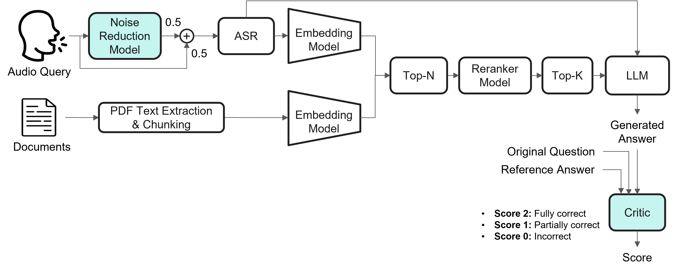
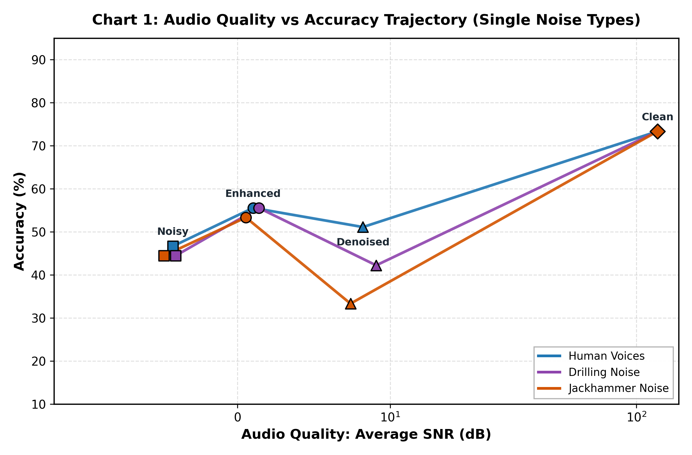
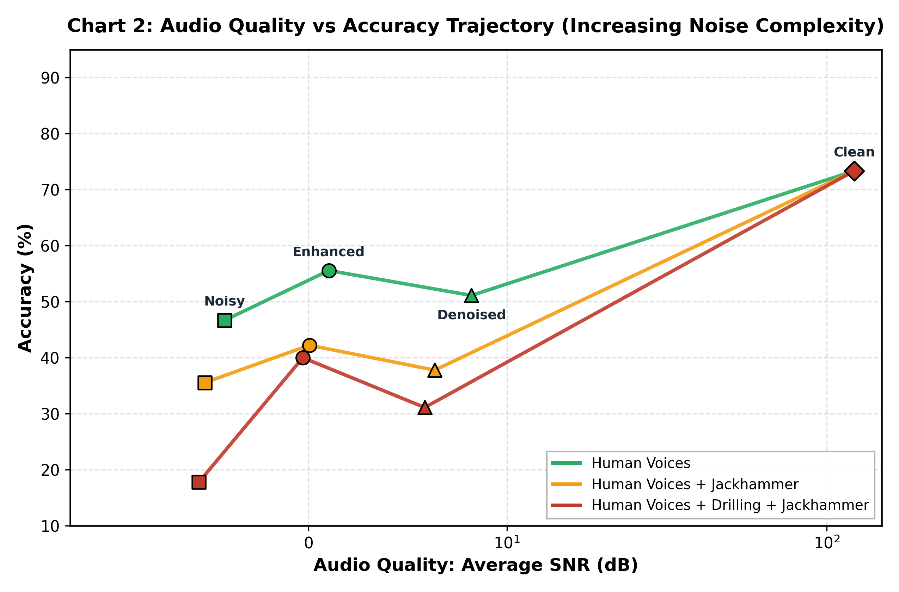
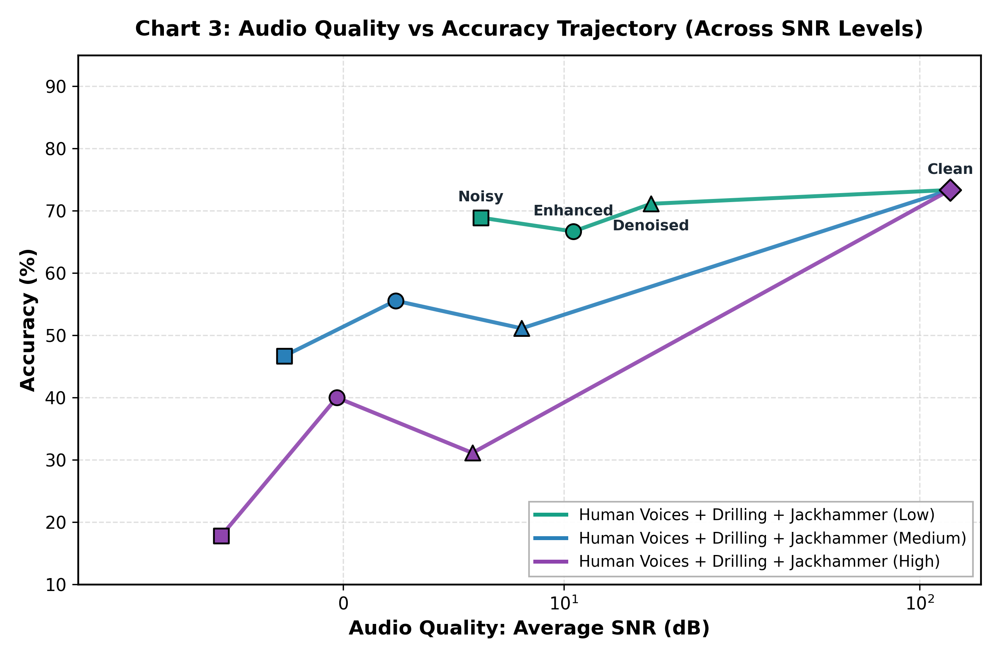
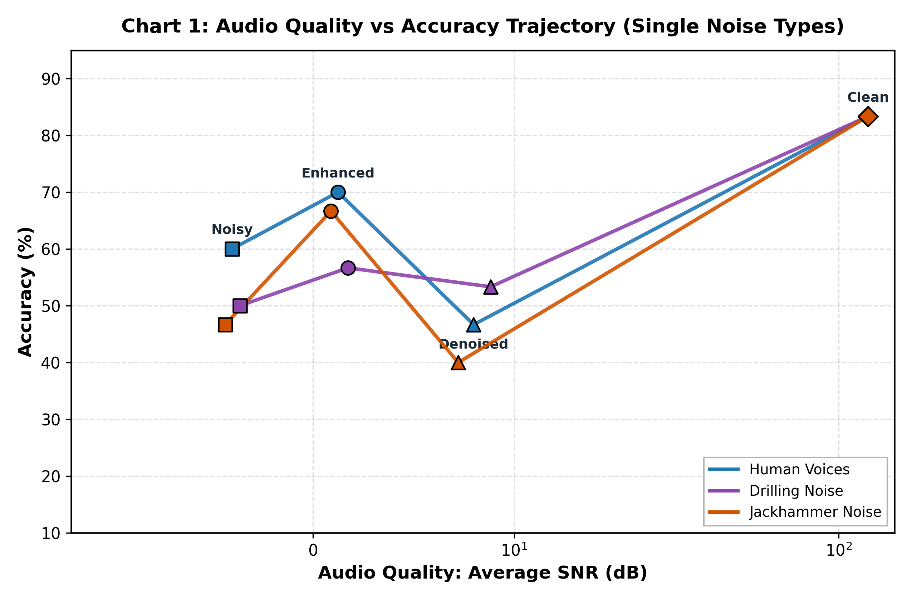
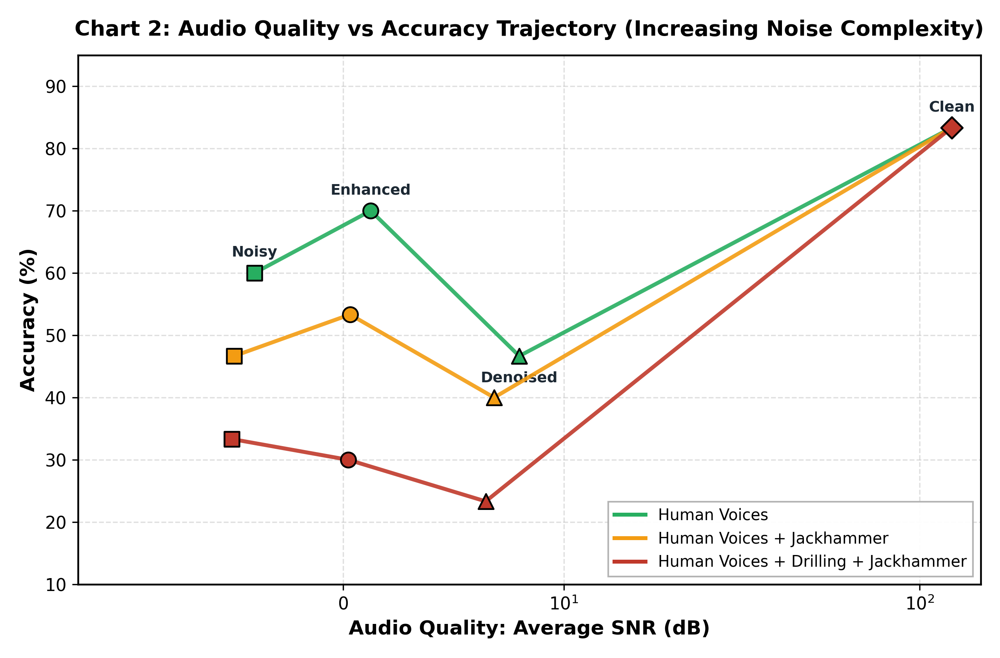
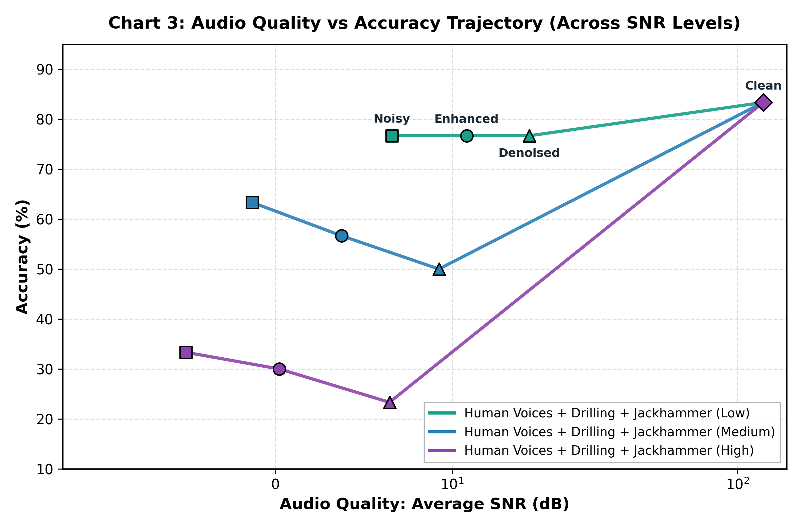

# Noise Reduction for Reliable LLM

This project investigates the impact of background noise and speech enhancement on Large Language Model (LLM)-based question answering in industrial environments.

## Experimental Workflow

### Step 1. Generate Question Dataset and Speech Audio

1. Provide the original PDF to an LLM (e.g., ChatGPT) to generate question-answer pairs in JSON format.
2. Place both the original PDF and the generated JSON file in the `datasets/` directory.
3. Use [ElevenLabs Text to Speech](https://elevenlabs.io/app/speech-synthesis/text-to-speech) to convert the questions into MP3 audio.
4. Convert MP3 files to WAV:

   ```bash
   python mp3towav.py --input $folder$ --output datasets/testB
   ```

   **Parameters:**
   - `--input`: Input folder containing MP3 files.
   - `--output`: Output folder for converted WAV files.

### Step 2. Generate Noisy Audio

1. Download the **UrbanSound8K** dataset: [UrbanSound8K Dataset](https://urbansounddataset.weebly.com/urbansound8k.html). After downloading, extract the dataset into the `datasets/` directory.

2. Run the following command to generate noisy audio. The generated audio will be saved in `datasets/testA/`.

   ```bash
   python white_noise_dataset_generator.py --SNR $SNR$ -type $type$
   ```

   **Parameters:**
   - `--SNR`: Signal-to-Noise Ratio. Available values: `-8`, `-4`, `4`. Lower values indicate stronger noise.
   - `-type`: Noise types (`0–9`). Multiple types can be selected using commas (e.g., `2,4,7` selects `children_playing`, `drilling`, and `jackhammer`). Available types: `0` air_conditioner, `1` car_horn, `2` children_playing, `3` dog_bark, `4` drilling, `5` engine_idling, `6` gun_shot, `7` jackhammer, `8` siren, `9` street_music.


### Step 3. Run Noise Reduction and LLM Evaluation

1. Make sure the required PDF, QA JSON, and audio directories are available in `datasets/`.

2. Run the evaluation separately for Chinese and English audio:

   ```bash
   python main.py --type $language$ --pdf $your_pdf_path$ --qa $your_json_path$
   ```

   **Parameters:**
   - `--type`: Language selection (`EN` for English, `CH` for Chinese).
   - `--pdf`: Path to the reference PDF document for RAG retrieval.
   - `--qa`: Path to the QA JSON file containing questions and reference answers.

### Step 4. System Architecture and Experimental Results

**System Architecture**

<p align="center">
  
</p>

**Visualize Results**

After completing the experiments, generate the accuracy comparison plots:

```bash
python plot_accuracy_comparison.py
```

   **Final directory structure:**

   ```text
   **Project Directory Structure:**

```text
Project/
├── datasets/
│   ├── UrbanSound8K/
│   ├── testA/
│   ├── testB/
│   ├── your_document.pdf
│   └── your_questions.json
│
├── models/
│   ├── faster-whisper-large-v3-turbo/
│   ├── faster-whisper-small.en/
│   ├── bge-small-zh-v1.5/
│   ├── bge-reranker-v2-m3/
│   ├── gemma-4-31B/
│   └── ...
│
├── Figure/
├── result/
├── outputs/
├── utils/
│
├── main.py
├── mp3towav.py
├── plot_accuracy_comparison.py
├── white_noise_dataset_generator.py
└── README.md
```
   ```

## Experimental Results

### English Results (EN)

<p align="center">
  
  
  
</p>

### Chinese Results (CH)

<p align="center">
  
  
  
</p>

## Acknowledgements and References

This project is developed with reference to the following works:

**Code Development References**
- [Noise2Noise: Audio Denoising without Clean Training Data](https://github.com/madhavmk/Noise2Noise-audio_denoising_without_clean_training_data)
- *Focus Then Listen: An Empirical Study of Plug-and-Play Audio Enhancer for Noise-Robust Large Audio Language Models.*

**Research Reference**
- *Robust Tool Wear Prediction under Novel Operating Conditions via Physics-Guided Unsupervised Domain Adaptation.*

We sincerely thank the authors for their valuable contributions and research, which provided useful references for the development and experimental design of this project.
